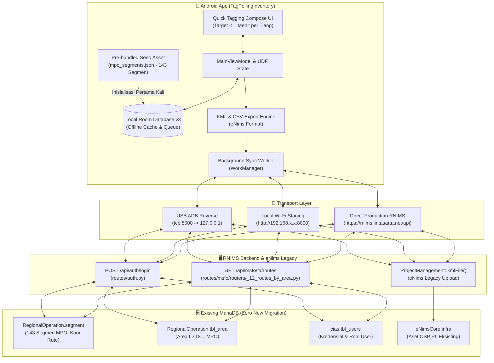

# 🎯 GOAL.md: Master Goal & Autonomous Execution Blueprint

Dokumen ini adalah **Master Goal Specification** untuk eksekusi implementasi proyek **TagPollingInventory** di conversation baru. Dokumen ini dirancang sebagai panduan tunggal (*single source of truth*) yang siap dipicu menggunakan perintah `/goal` atau `/plan`.

Dokumen pendamping teknis:
- 🗺️ **Rencana Detail & Roadmap:** [`PLANNING.md`](file:///D:/PROJECT%20RNIMS/TagPollingInventory/PLANNING.md)
- 🛡️ **Pedoman Ketat & Aturan Domain:** [`RULES.md`](file:///D:/PROJECT%20RNIMS/TagPollingInventory/RULES.md)
- 📊 **Kamus Data & Skema ERD Resmi:** [`ERD_dan_Struktur_Database_RNIMS.pdf`](file:///D:/PROJECT%20RNIMS/TagPollingInventory/ERD_dan_Struktur_Database_RNIMS.pdf)

---

## 1. Visi & Target Utama Proyek

1. **Tagging Tiang Super Cepat (Target < 1 Menit per Tiang):**
   - Alur kerja lapangan yang ringkas (GPS auto-lock < 10m, kamera terkompresi < 500 KB ber-watermark, penomoran otomatis tiang, simpan instan 1-klik).
2. **100% Offline-First:**
   - Aplikasi dapat beroperasi penuh di wilayah tanpa sinyal seluler (misal: pedalaman Papua/Maluku).
   - Seluruh data segmen, rute, dan tiang tersimpan di SQLite lokal (Room v3) beserta file seed bawaan 143 segmen MPO.
3. **Zero Manual Segment & Route Entry:**
   - Menghilangkan proses ketik manual nama segmen dan import rute yang selama ini menghambat.
   - Segmen dan jalur optik ditarik otomatis dari database RNIMS berdasarkan **Area Operation** pengguna (Prioritas Pilot: **MPO - Maluku Papua Operation / Area ID 18**, 143 segmen).
4. **Zero New Migrations / Zero New DB Tables:**
   - **TIDAK MEMBUAT TABEL ATAU MIGRASI BARU** di database MariaDB server.
   - Pemanfaatan strategi **Hybrid Opsi 1 + Opsi 3**:
     - **Opsi 3:** Berkas KML As-Built diunggah sebagai dokumen serah terima dan arsip resmi ke filesystem server.
     - **Opsi 1:** Titik tiang dimasukkan langsung ke tabel master OSP **`infra`** bawaan eNims (`infraTypeId = 2`).
5. **Direct RNIMS API Integration (Existing Endpoints):**
   - Menggunakan endpoint bawaan RNIMS FastAPI:
     - Auth: `POST /api/auth/login`
     - Rute/Segmen: `GET /api/msfo/ta/routes?area_id={area_id}`
6. **Dual Staging Environment (Laptop Bridge to Production Direct):**
   - Mode staging laptop via Wi-Fi (`http://<ip-laptop>:8000`) dan kabel USB (`adb reverse tcp:8000 tcp:8000` -> `http://127.0.0.1:8000`).
   - Kemampuan beralih ke URL server produksi RNIMS secara transparan begitu pengujian selesai.

---

## 2. Diagram Alur Kerja Terpadu (Mobile <===> Server)



---

## 3. Kriteria Penerimaan (Definition of Done)

Proyek dinyatakan **SELESAI dan SUKSES** jika memenuhi seluruh checklist berikut:

- [ ] **Standarisasi Model Alpaca PRA:** Seluruh entitas tiang (`PoleEntity`) menggunakan klasifikasi resmi Alpaca `pole_7` (T7, 7 meter) dan `pole_9` (T9, 9 meter), dengan `asset_uid` berformat `POL-MPO-[KOTA]-[SEQ:04d]`.
- [ ] **Pemilihan Rute Hybrid MPO:** Tersedia quick filter chips rute Alpaca MPO (Sentani-Abepura, Manokwari, Timika, Sorong, Dobo, Tiakur) + katalog offline 143 segmen MPO + input manual rute/PO baru.
- [ ] **Auto-Route & Offline Map:** Memilih rute otomatis memuat koordinat rute polyline pada peta offline OpenStreetMap.
- [ ] **Login & Profil Area:** Login terhubung ke RNIMS, menyimpan session lokal offline (cached PIN), dan mengunci area kerja ke MPO (Area 18).
- [ ] **Kecepatan Tagging (< 1 Menit):** GPS auto-lock (< 10m), toggle 1-tap P7/P9, kamera CameraX dengan overlay panduan tiang, kompresi JPEG < 400 KB ber-watermark.
- [ ] **Ekspor Master Alpaca:** Hasil tagging sukses diekspor menjadi berkas `Alpaca_Master_Poles.csv` dan `Alpaca_Master.kmz` yang 100% kompatibel dengan parser backend eNims `Alpaca_kmz.py`.
- [ ] **Dual Staging:** Aplikasi dapat berkomunikasi dengan laptop staging baik via alamat IP Wi-Fi maupun port forward USB ADB reverse (`adb reverse tcp:8000 tcp:8000`).
- [ ] **Zero Server DB Alteration:** Database MariaDB server tidak mengalami penambahan tabel baru atau perubahan skema.
- [ ] **Kualitas Kode & Build:** `./gradlew assembleDebug` dan `./gradlew testDebugUnitTest` sukses tanpa error kompilasi.
- [ ] **Git Hygiene & Mandatory Push:** Seluruh perubahan di-commit dengan rapi dan berhasil di-push ke remote `origin/master`.

---

## 4. Perintah Pemicu untuk Percakapan Baru

Untuk langsung memulai pengerjaan di percakapan baru, gunakan perintah slash `/goal` berikut:

```text
/goal Jalankan seluruh rencana rekonstruksi TagPollingInventory sesuai dengan dokumen PROMPT_REKONSTRUKSI_V3_ALPACA.md, PLANNING.md, RULES.md, dan GOAL.md di direktori D:\PROJECT RNIMS\TagPollingInventory. Pastikan mematuhi semua batasan: standarisasi model Alpaca PRA (pole_7/pole_9), 100% offline-first, tagging < 1 menit, navigasi rute hybrid MPO, ekspor Alpaca_Master_Poles.csv & KMZ, build sukses, dan lakukan git commit + git push origin master di akhir pekerjaan.
```
