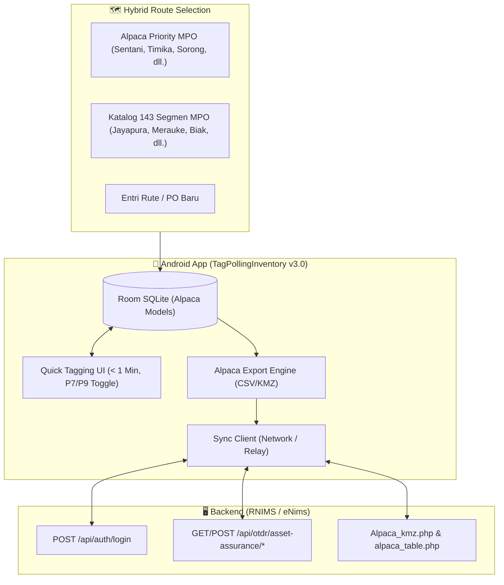

# 🗺️ PLANNING.md: Rencana Aksi Rekonstruksi TagPollingInventory (v3.0 — Alpaca PRA Standard)

Dokumen ini adalah **Roadmap dan Rencana Rekonstruksi Bertahap** untuk membawa aplikasi mobile **TagPollingInventory** dari kondisi saat ini menjadi aplikasi lapangan produksi offline-first berkecepatan tinggi yang terintegrasi penuh dengan standar **Project Alpaca PRA (Poles Rental Agreement)** pada ekosistem backend **RNIMS 2.0 & eNims**.

---

## 1. Ikhtisar Arsitektur & Standar Alpaca PRA

Berdasarkan arahan resmi atasan dan analisis sistem:
- **Standar Model Alpaca PRA:**
  - **Klasifikasi Tiang:** Wajib mendukung `pole_7` (T7, 7 meter) dan `pole_9` (T9, 9 meter).
  - **Identitas Tiang (Asset UID):** Format standar `POL-MPO-[KOTA]-[SEQ:04d]` (contoh: `POL-MPO-TMK-0001`).
  - **Format Ekspor Master:**
    - `Alpaca_Master_Poles.csv` (kompatibel dengan parser backend eNims `Alpaca_kmz.py`).
    - `Alpaca_Master.kmz` (Placemark titik tiang P7/P9 beserta rute dan foto untuk Google Earth).
- **Strategi Pemilihan Rute Hybrid (Maluku Papua):**
  - **Lapis 1 (Quick Chips):** Rute prioritas Alpaca MPO (Sentani-Abepura, Manokwari, Timika, Sorong, Dobo, Tiakur).
  - **Lapis 2 (Katalog Lengkap):** 143 segmen MPO RNIMS offline seed (`app/src/main/assets/mpo_segments.json`).
  - **Lapis 3 (Custom Route/PO):** Entri manual rute/PO untuk jalur ekspansi baru di lapangan.
- **Aturan Mutlak:** **Zero New Migration & Zero New DB Tables** pada MariaDB server.
- **Karakteristik Lapangan:** **100% Offline-First** dengan target kecepatan **< 1 menit per tiang**.
- **Kontrol Versi Git:** Setelah verifikasi build selesai, wajib melakukan commit terstruktur dan push ke remote `origin/master`.



---

## 2. Fase-Fase Rekonstruksi

### 📍 FASE 1: Harmonize Domain & Room Entity (Alpaca PRA Models)
* **Tugas:**
  1. Perbarui `Models.kt` dan `RouteModels.kt`:
     - Tambahkan enum / class `AssetClass` (`POLE_7`, `POLE_9`) dan `MatchStatus`.
     - Update `PoleEntity` dengan kolom: `assetUid`, `assetClass`, `routeName`, `poId`, `matchStatus`, `photoPath`, `syncStatus`.
     - Update `SegmentEntity` dengan kolom: `isAlpacaProject`, `cityFilterKey`.
  2. Perbarui `InventoryDao.kt` dan `AppDatabase.kt` (migrasi schema Room tanpa data loss).

---

### 📍 FASE 2: Hybrid Route & Segment Explorer
* **Tugas:**
  1. Perbarui `SegmentExplorerScreen.kt`:
     - Quick Filter Chips kota & rute prioritas Alpaca MPO.
     - Auto-Suggest segmen terdekat (< 500m) dari posisi GPS surveyor.
     - Pilihan tombol "Tambah Rute / PO Baru" untuk rute yang belum terdaftar.
  2. Pastikan file seed `app/src/main/assets/mpo_segments.json` termuat dengan mulus ke Room saat database diinisialisasi.

---

### 📍 FASE 3: Ultra-Fast Tagging Canvas (< 1 Menit)
* **Tugas:**
  1. Perbarui `QuickTaggingScreen.kt`:
     - GPS Auto-Lock berlatar belakang dengan indikator akurasi satelit (Hijau, Kuning, Merah).
     - **Toggle Cepat Tipe Tiang Alpaca:** 2 tombol besar 1-tap `[ Tiang 7M (P7) ]` vs `[ Tiang 9M (P9) ]`.
     - Rumus penomoran otomatis `POL-MPO-[KOTA]-[SEQ:04d]`.
     - Tampilan kamera CameraX potret dengan siluet panduan tiang dan kompresi JPEG otomatis (< 400 KB) ber-watermark.
     - Tombol 1-tap: *"SIMPAN & LANJUT KE TIANG BERIKUTNYA"*.

---

### 📍 FASE 4: Alpaca Export Engine & Sync Client
* **Tugas:**
  1. Perbarui `ExportEngine.kt`:
     - Ekspor `Alpaca_Master_Poles.csv` (format tabel master eNims).
     - Ekspor `Alpaca_Master.kmz` (styling icon P7/P9 + file foto tiang di dalam bundle zip KMZ).
  2. Implementasikan layar `ReviewExportSyncScreen.kt` dengan kartu ringkasan (Total T7, Total T9, Total Tiang, Estimasi Jarak Rata-rata Span).
  3. Siapkan client sinkronisasi dual staging (Wi-Fi/USB).

---

### 📍 FASE 5: Verifikasi Build, Pengujian & Git Push
* **Tugas:**
  1. Jalankan `./gradlew testDebugUnitTest` untuk memvalidasi parser dan logic model.
  2. Jalankan `./gradlew assembleDebug` memastikan build APK sukses tanpa error.
  3. **Git Hygiene & Push:**
     ```bash
     git status
     git add .
     git commit -m "feat(alpaca): refactor TagPollingInventory to support Alpaca PRA standard with P7/P9 models, offline-first MPO routing, and master export"
     git push origin master
     ```

---

### 📍 FASE 4: Mesin Sinkronisasi & Dual Staging (Kirim Balik ke Server)
* **Status:** Prioritas #4
* **Masalah Lapangan:** Data hasil tagging harus dikirim kembali ke server laptop (staging) atau server live tanpa migrasi tabel baru.
* **Solusi & Tugas:**
  1. **Konfigurasi Staging Fleksibel di Menu Settings:**
     - Pilihan Mode Koneksi:
       - **Wi-Fi Lokal:** `http://<IP-Laptop>:8000` (atau port 5173).
       - **Kabel USB ADB:** `http://127.0.0.1:8000` (menggunakan perintah `adb reverse tcp:8000 tcp:8000`).
       - **Produksi RNIMS Direct:** `https://rnims.lintasarta.net/api`.
     - Tombol *"Test Connection"* (Ping `GET /api/health`) dengan indikator latensi ms.
  2. **Ekspor & Unggah KML As-Built (Opsi 3):**
     - Mobile app mempaketkan data tiang segmen yang telah selesai disurvei menjadi berkas KML standar.
     - Unggah file KML via multipart ke backend server.
  3. **Batch Sync ke Tabel `infra` (Opsi 1):**
     - Kirim payload batch JSON ke backend untuk disimpan langsung ke tabel `infra` eNims (`siteId`, `latitude`, `longitude`, `infraSysId`, `infraTypeId=2`).
  4. **Antrean Unggah Foto Terpisah (Background Worker):**
     - Berkas foto diunggah secara asynchronous di background menggunakan `WorkManager` agar tidak memblokir aplikasi jika koneksi internet terputus-putus.

---

### 📍 FASE 5: Uji Validasi, Build, & Serah Terima
* **Status:** Prioritas #5
* **Tugas:**
  1. **Unit Testing:** Jalankan `./gradlew testDebugUnitTest` untuk memvalidasi:
     - Parser JSON rute segmen RNIMS.
     - Logika auto-numbering eNims (`PL-TMK-KKC-xxx`).
     - Pembuatan format berkas KML & CSV.
  2. **Build Compile APK:** Jalankan `./gradlew assembleDebug` memastikan APK sukses dibuat tanpa error.
  3. **Uji Skenario Lapangan (Airplane Mode):** Uji coba alur tagging 10 tiang dalam mode pesawat untuk membuktikan 100% offline-first.

---

## 3. Jadwal & Pembagian Kerja di Conversation Baru

| Tahap Kerja | Estimasi Langkah | Deliverable Utama |
|---|---|---|
| **Langkah 1** | Inisialisasi Seed & Segmen Picker | File seed MPO aktif di Room, input manual segmen hilang |
| **Langkah 2** | Integrasi Auth & User Profile | Login RNIMS berfungsi (online + offline cache), area terfilter ke MPO |
| **Langkah 3** | Quick Tagging Flow (< 1 Menit) | GPS auto-lock, auto-naming tiang eNims, kompresi foto |
| **Langkah 4** | Engine Sinkronisasi (KML + API) | Berkas KML & payload tiang sukses terkirim ke server laptop |
| **Langkah 5** | Build APK & Verifikasi Akhir | File `TagPollingInventory-debug.apk` siap uji di HP fisik |
