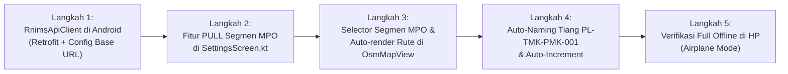

# 📋 Hasil Diskusi & Rencana Integrasi Data RNIMS (Fokus Area MPO)

**Lokasi Proyek:** `D:\PROJECT RNIMS\TagPollingInventory` (Android Jetpack Compose)  
**Backend API Resmi:** **RNIMS (FastAPI)** di `D:\PROJECT RNIMS\VSCODE`  
**Sumber Master Data:** Database MariaDB (`RegionalOperation` & `cias` di Docker host `rnims-db-local`)  
**Prinsip Utama:** **100% Zero Database Migration & Tanpa Penambahan Router Baru di Backend**, memanfaatkan kontrak API resmi RNIMS yang sudah eksis.

---

## 1. Arsitektur Final: Klien Android ➔ Endpoint Resmi RNIMS

Aplikasi Android `TagPollingInventory` langsung memanfaatkan **endpoint resmi RNIMS yang sudah ada**:

1. **Autentikasi & Profil Surveyor:**
   - Memanggil `POST /api/auth/login` resmi RNIMS.
   - Respons `SessionResponse` mengembalikan `UserContext` dengan profil surveyor dan area kerja: `areaId: 18` (`MPO`) & `areaLabel: "MPO"`.
2. **Master Segmen & Rute Area MPO:**
   - Memanggil `GET /api/msfo/ta/routes?area_id=18` resmi RNIMS.
   - Menarik 143 segmen fiber optik Maluku Papua beserta ribuan titik koordinat jalur `route_path` (~290 KB).
3. **Penyimpanan Hasil Survei di Lapangan:**
   - Disimpan secara lokal di SQLite Room saat offline di lapangan.
   - Diekspor dalam format As-Built standar (`.kml`, `.geojson`, `.csv`) yang kompatibel langsung dengan sistem eNims [ProjectManagement.php](file:///d:/PROJECT%20RNIMS/VSCODE/123.231.138.38/eNims/application/controllers/ProjectManagement.php).
4. **Fleksibilitas Staging ke Produksi:**
   - Selama masa develop: aplikasi mengarah ke laptop staging (`localhost:8000` via USB ADB / `192.168.x.x:8000` via Wi-Fi).
   - Setelah selesai: konfigurasi `BASE_URL` **langsung direct ke server produksi RNIMS**.

---

## 2. Pemetaan Struktur Database Eksisting (Tanpa Tabel Baru)

| Fitur Mobile | Endpoint / Tabel Eksisting | Penjelasan |
| :--- | :--- | :--- |
| **1. Auth & Profile** | `POST /api/auth/login` (Tabel: `cias.tbl_users`) | Login resmi RNIMS, otomatis mendeteksi personil MPO (`areaId: 18`). |
| **2. Segmen & Rute** | `GET /api/msfo/ta/routes?area_id=18` (Tabel: `RegionalOperation.segment`) | Menarik seluruh 143 segmen MPO beserta polyline koordinat GPS jalan tanpa perlu file KML. |
| **3. Hasil Tag Pole** | SQLite Room Lokal (`Pole` entity) + Export As-Built KML/GeoJSON | Mengadopsi standar penamaan eNims `PL-[ORG]-[DST]-[SEQ]` (contoh: `PL-TMK-PMK-001`). |

---

## 3. Rencana Eksekusi Bertahap

1. **Langkah 1: Network Client Android (`RnimsApiClient.kt`)**  
   Menyiapkan Retrofit service di Android yang mengarah ke `POST /api/auth/login` dan `GET /api/msfo/ta/routes?area_id=18` dengan toggle URL staging (USB/Wi-Fi) vs produksi.
2. **Langkah 2: Sinkronisasi MPO di Settings (`SettingsScreen.kt`)**  
   Menambahkan panel koneksi (Test Ping) dan tombol `[Tarik Segmen MPO]` untuk menyimpan 143 segmen ke Room DB lokal.
3. **Langkah 3: Selector Segmen & Auto-Display Peta (`CreateSegmentScreen.kt`)**  
   Mengganti form manual dengan dialog pencarian segmen MPO. Saat segmen dipilih, garis rute FO biru langsung tergambar di `OsmMapView.kt` tanpa KML.
4. **Langkah 4: Auto-Numbering Tiang (`InventoryRepository.kt`)**  
   Menyempurnakan format kode tiang otomatis (`PL-TMK-PMK-001`) dan auto-increment saat tombol simpan ditekan untuk mengejar target survey < 1 menit.
5. **Langkah 5: Pengujian Lapangan & Build APK**  
   Build debug APK, tes skenario offline (Airplane Mode), dan verifikasi ekspor hasil survey.
